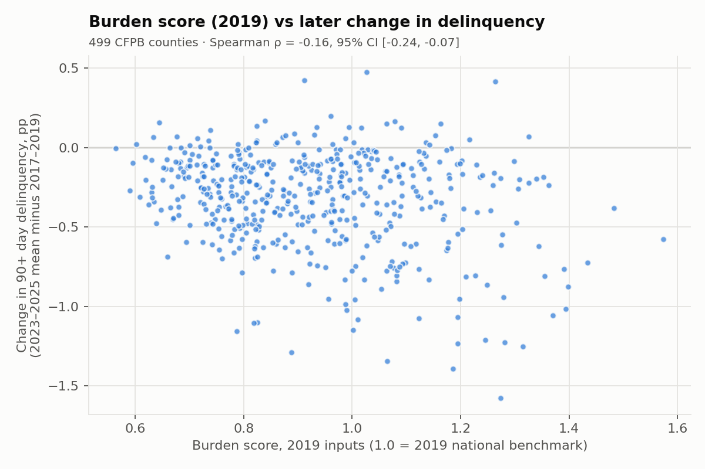
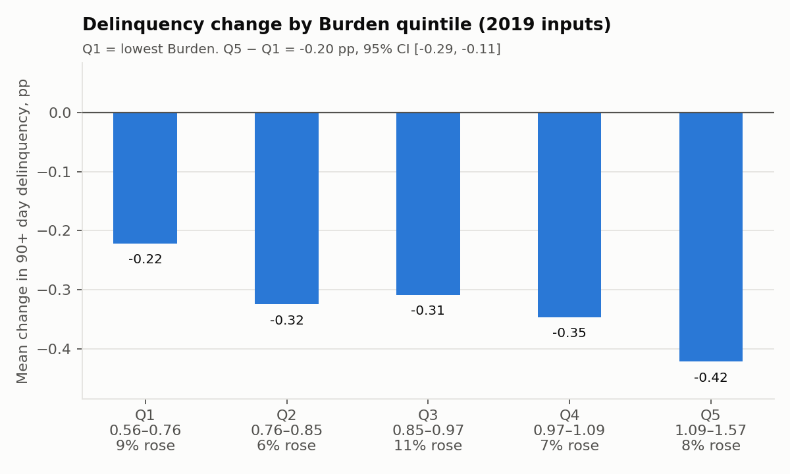
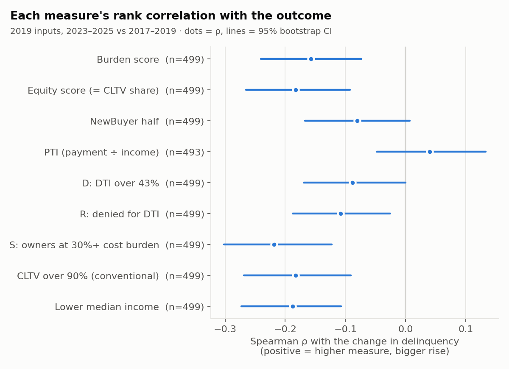

# Phase 4b backtest: did the 2019 scores anticipate delinquency?

Run once on 2026-10-16 (`pipeline/backtest.py`). The design is in SPEC.md Phase 4 and DECISIONS 022. The analysis details were fixed in DECISIONS 028 and committed (`ecaca85`) before any 2019 county score existed. Every number below is in `reports/backtest/results.json`, and each county's scores and outcomes are in `reports/backtest/county_scores.json`.

## Short answer

**No. On this test, the index did not anticipate rising delinquency.** Counties with a higher 2019 Burden score saw delinquency fall *more* afterwards, not rise more. Burden's Spearman ρ is −0.16 (95% CI −0.24 to −0.07). Every input except PTI points the same way, and so does the simple income baseline. The result holds with 2018 inputs and with a 2024–2025 outcome window.

The most likely reason is the outcome, not the index. Delinquency fell in 92% of these counties between 2017–2019 and 2023–2025. How far a county fell depends mostly on where it started: counties with high 2017–2019 rates fell the most. Burden is higher where 2017–2019 delinquency was higher, so it inherits that pattern. The test, as designed, can't tell "the index doesn't work" apart from "the outcome mostly measures how far each county had to fall". See [What the evidence does and doesn't support](#what-the-evidence-does-and-doesnt-support).

A single **pre-specified secondary analysis**, added after the primary result because of that diagnosis, ranks each county's 2023–2025 delinquency *level* while controlling for its 2017–2019 level. **Burden comes out at essentially zero there** (partial ρ = +0.006, CI −0.083 to +0.091). Three of its inputs, D, R and CLTV, point the expected way, but PTI and S point the other way and cancel them out. Lower income alone does better (+0.27). See [Secondary analysis](#secondary-analysis-pre-specified-added-after-the-primary-result).

## Setup

| | |
|---|---|
| Counties | 499: every county CFPB publishes, minus the 8 Connecticut planning regions |
| Scores | the index's own `compute()`, with HMDA 2019 One-Year, ACS 2015–2019, FIO 2019 premiums (Q4 2019 crosswalk) and the fixed 2019 benchmarks |
| Outcome | mean 90+ day delinquency rate, 2023-01 to 2025-12, minus the mean for 2017-01 to 2019-12, in percentage points (CFPB file through 2025-12) |
| Metrics | Spearman ρ; outcome by quintile; 95% percentile bootstrap CIs, 1,000 resamples of counties, seed 20261016 |
| Orientation | positive ρ = "higher measure, bigger rise", which is the direction the index assumes. Income enters reversed, as "lower income". |

PTI loan rules (DECISIONS 025): in 2019, 7.7% of 3,845,379 qualifying loans were removed and 49 backtest counties lose more than 10% of their loans. In 2018 it's 9.2% and 95 counties.

## Results (main run)

| Measure | n | ρ | 95% CI | Q5 − Q1, pp | 95% CI |
|---|---|---|---|---|---|
| **Burden score** | 499 | **−0.157** | −0.241 to −0.074 | −0.200 | −0.287 to −0.109 |
| Equity score (= CLTV share) | 499 | −0.183 | −0.265 to −0.092 | −0.095 | −0.195 to −0.010 |
| NewBuyer half | 499 | −0.080 | −0.167 to +0.007 | −0.107 | −0.191 to −0.034 |
| PTI | 493 | +0.040 | −0.048 to +0.133 | −0.030 | −0.126 to +0.060 |
| D: DTI over 43% | 499 | −0.088 | −0.170 to +0.000 | −0.152 | −0.230 to −0.065 |
| R: denied for DTI | 499 | −0.108 | −0.188 to −0.026 | −0.071 | −0.160 to −0.011 |
| S: owners at 30%+ cost burden | 499 | −0.219 | −0.302 to −0.123 | −0.228 | −0.308 to −0.138 |
| CLTV over 90% (conventional) | 499 | −0.183 | −0.268 to −0.091 | −0.095 | −0.187 to −0.003 |
| Baseline: lower median income | 499 | −0.188 | −0.273 to −0.107 | −0.105 | −0.177 to −0.013 |

Equity is x_CLTV, so it ranks counties exactly as the CLTV share does. Its ρ only differs from the CLTV row in the bootstrap CI.

By Burden quintile (Q1 lowest), the mean change runs −0.22, −0.32, −0.31, −0.35 and −0.42 pp. Between 6% and 11% of counties in each quintile saw delinquency rise.

### Does Burden beat its best single input?

This is a paired bootstrap of ρ(Burden) − ρ(input) on the same counties. A positive difference means Burden is closer to the expected direction than the input.

| Burden − input | n | difference | 95% CI |
|---|---|---|---|
| PTI | 493 | −0.189 | −0.253 to −0.124 |
| D | 499 | −0.069 | −0.127 to −0.004 |
| R | 499 | −0.049 | −0.124 to +0.039 |
| S | 499 | +0.062 | +0.024 to +0.102 |

**No.** Burden beats only S, and only because S points the "wrong" way most strongly. PTI, the one input with a positive ρ, does better than Burden. Since almost everything is negative, "beating" a component here mostly means being less negative, so this table can't show that combining inputs adds value.

## Robustness

| Run | Burden ρ | 95% CI | Q5 − Q1, pp |
|---|---|---|---|
| Main (HMDA 2019, outcome 2023–2025) | −0.157 | −0.241 to −0.074 | −0.200 |
| HMDA 2018 Snapshot + FIO 2018 premiums | −0.159 | −0.240 to −0.075 | −0.211 |
| HMDA 2019, outcome 2024–2025 | −0.112 | −0.197 to −0.025 | −0.170 |

All three runs agree, and the component patterns match too (`results.json`, `runs`). Note that the 2018 Snapshot names CLTV `loan_to_value_ratio`. It's the same field, renamed in code (DATA_SOURCES.md, Phase 4b note).

## Diagnostic: regression to the mean (post hoc)

*This was not part of the planned test. I ran it afterwards to understand the sign, and it changes no number above.*

- Delinquency **fell** in 457 of 499 counties (92%), was unchanged in 1 and rose in 41. The median change is −0.27 pp, against a median 2017–2019 rate of 0.91%.
- A county's 2017–2019 level predicts its change very strongly: ρ(baseline level, outcome) = **−0.77**.
- Burden is mildly higher where the baseline was higher: ρ(Burden, baseline) = +0.22. Lower income is more so: ρ = +0.40.

So most of the variation in the outcome is counties falling back from their 2017–2019 levels. Any measure that tracks the baseline level picks up a negative ρ, which fits income and S showing the most negative ρ.

## Secondary analysis (pre-specified, added after the primary result)

*Added after the primary result was seen, because of the regression-to-the-mean diagnosis above. It was specified by the owner and logged as DECISIONS 029 (`3307681`) before any code computed it. It's the only secondary analysis, it's reported whatever its sign, and it doesn't replace the headline.* Output: `reports/backtest/secondary.json` (`pipeline/backtest_secondary.py`).

- **Outcome:** each county's mean 90+ day delinquency level, 2023-01 to 2025-12.
- **Test:** Spearman partial correlation with the 2019 measure, controlling for the 2017–2019 mean level. All three variables are ranked; the outcome ranks and the measure ranks are each regressed on the baseline ranks, and the residuals are correlated. It asks: among counties that started at the same delinquency level, did higher-scoring ones end up higher?
- 95% percentile bootstrap, 1,000 resamples, seed 20261016. Same 499 counties, same 2019 scores as the primary run. Positive = the expected direction.

| Measure | n | partial ρ | 95% CI |
|---|---|---|---|
| **Burden score** | 499 | **+0.006** | −0.083 to +0.091 |
| PTI | 493 | −0.115 | −0.204 to −0.028 |
| D: DTI over 43% | 499 | +0.133 | +0.047 to +0.223 |
| R: denied for DTI | 499 | +0.228 | +0.143 to +0.307 |
| S: owners at 30%+ cost burden | 499 | −0.143 | −0.228 to −0.050 |
| CLTV over 90% (= Equity score) | 499 | +0.336 | +0.251 to +0.418 |
| Baseline: lower median income | 499 | +0.266 | +0.178 to +0.350 |

**Reading it:**
- **Burden has no detectable signal** beyond the baseline level. Its CI is centred on zero.
- Once the baseline is controlled for, **the negative pull disappears for D, R and CLTV**, which all point the expected way. CLTV, and so the Equity score, is the strongest at +0.34.
- **PTI and S point the opposite way.** Burden averages them with D and R, and they cancel out.
- **Lower income alone (+0.27) beats Burden** and every Burden input. D, R and CLTV may partly be standing in for income here; this test can't separate them.
- Per SPEC, none of this changes the weights or benchmarks. Seeing which components "worked" and re-weighting toward them would be tuning on the test.

## What the evidence does and doesn't support

**Supports:**
- With this outcome definition, a higher 2019 Burden score went with a *larger fall* in 90+ day delinquency by 2023–2025 across 499 mostly metropolitan counties. The result is stable across input years and outcome windows.
- PTI is the only input with a positive point estimate, and its CI includes zero.
- In the secondary analysis, among counties starting from similar 2017–2019 levels, Burden shows **no** relationship with the 2023–2025 level. D, R, CLTV (Equity) and lower income do show the expected relationship.

**Doesn't support:**
- **That the index works.** Neither test shows the Burden score anticipated stress. The secondary result for Equity is suggestive only: it was chosen after the primary result, and lower income alone does nearly as well.
- **That the index doesn't work.** In a period when delinquency fell almost everywhere, the planned outcome is dominated by regression to the mean, so it may not be able to show a signal the index has. A null or negative result under these conditions doesn't refute the theory (DECISIONS 022 anticipated this).
- Anything about rural counties: CFPB covers 499 mostly metropolitan counties.
- Changing weights or benchmarks. Per SPEC, they are never tuned on these results.

## Decision (2026-10-16)

The owner chose to run one pre-specified secondary analysis (above; DECISIONS 029), then to proceed to 4c with **the index presented as a description of current conditions, not a forecast** (DECISIONS 030).
