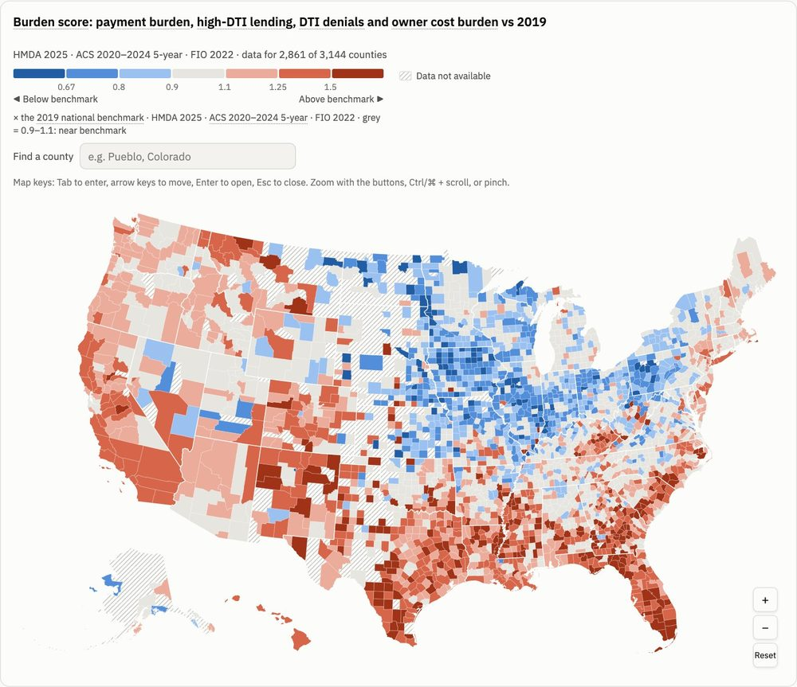

# US housing map

An interactive county map of US mortgage stress. It joins public Census, CFPB, HMDA and Treasury data into layers grouped by role (Outcome, Burden, Equity) and two index scores (Burden and Equity) measured against fixed 2019 benchmarks. A one-time backtest checked whether the 2019 Burden score anticipated later delinquency. It didn't, so the map describes current conditions and doesn't forecast defaults ([BACKTEST.md](BACKTEST.md)).



- **Live map:** https://jackrz412.github.io/us-housing-map/
- **Methodology:** https://jackrz412.github.io/us-housing-map/methodology.html

## Data sources

| Source | Used for |
|---|---|
| CFPB Mortgage Performance Trends | 90+ day delinquency, county (Outcome layer, backtest) |
| Census ACS 5-year (2020–2024; 2015–2019 for the backtest) | Owner cost burden, property tax, income, households |
| FFIEC HMDA loan-level data (2025; 2019 and 2018 for the backtest) | Payment-to-income, DTI, denials, CLTV, rates, loan amounts |
| Census Building Permits Survey | Permits per 1,000 households (click panel) |
| Treasury FIO homeowners insurance, 2018–2022, via the HUD USPS ZIP–county crosswalk | Insurance in payment-to-income |

Details, release timing and quirks: [DATA_SOURCES.md](DATA_SOURCES.md). Definitions: [METHODOLOGY.md](METHODOLOGY.md). Design and decisions: [SPEC.md](SPEC.md), [DECISIONS.md](DECISIONS.md).

## Running it

```sh
python3 -m venv .venv
.venv/bin/pip install -r requirements.txt

.venv/bin/python pipeline/refresh.py --check   # what changed upstream; changes nothing
.venv/bin/python pipeline/refresh.py --force   # download every source and rebuild every layer
.venv/bin/python pipeline/validate.py          # checks; exits non-zero on failure

.venv/bin/python -m unittest discover tests    # unit tests

scripts/build_site.sh                          # site/ + data/processed/ -> _site/
python3 -m http.server -d _site 8000           # preview at http://localhost:8000
```

- `refresh.py --force` downloads about 1 GB into `data/raw/` (about 6 GB once the HMDA file is unzipped), which git ignores.
- The scheduled job (`.github/workflows/refresh.yml`, Mondays 13:17 UTC) runs the same refresh. It commits `data/processed/` and redeploys only when the data changed.
- These one-off inputs are committed and not rebuilt by the refresh:
  - the 2019 benchmarks: `pipeline/build_benchmarks.py`;
  - the county insurance premiums: `pipeline/build_insurance.py`, which needs a HUD API token in a git-ignored `.env`.
- The backtest (`pipeline/backtest.py`, `backtest_secondary.py`) was run once and its results are committed. Rerunning it needs `requirements-report.txt`.

## Layout

```
pipeline/            fetch_*.py download, clean_*.py build layers, stress_index.py the index,
                     refresh.py and validate.py run and check it; analysis/ for one-off reports
site/                the map page (D3 + TopoJSON) and methodology page
data/processed/      the layer files the page loads, plus meta.json and sources.json (committed)
data/raw/            downloads (git-ignored)
reports/             backtest and regional comparison results
tests/               unit tests
scripts/             site build and one-off checks
.github/workflows/   weekly refresh and Pages deploy
```
